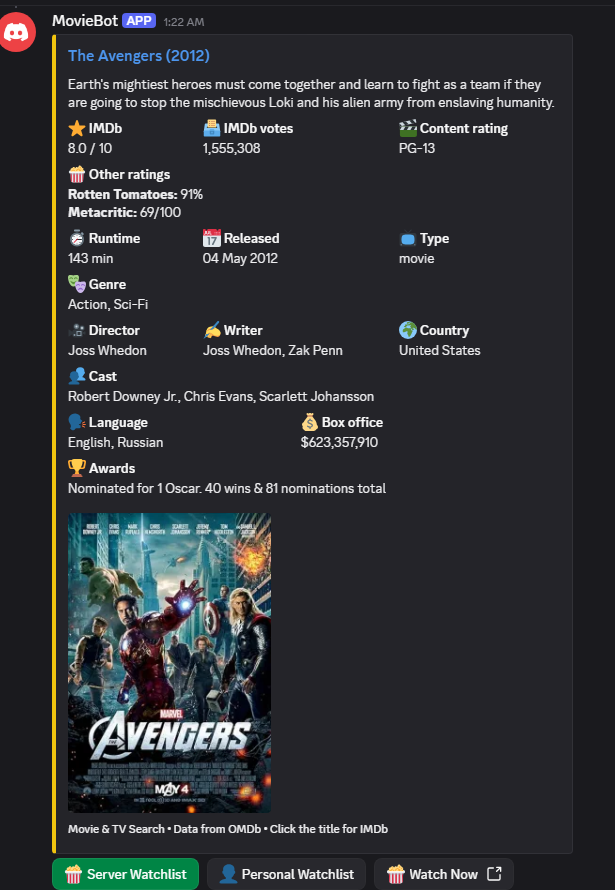

# OMDb Discord Bot


A self-hosted Discord bot that looks up movies and TV shows on OMDb, recommends movies, fetches trailers, and keeps watchlists, with a "Watch Now" button on results.

## Features

- Movie and TV lookup with poster, ratings, cast, awards, and an IMDb link (OMDb)
- Optional "Watch Now" link button on results when configured with custom streaming/watch URL templates. It is omitted when unconfigured or when a result has no IMDb ID.
- Random recommendations across 15 genres, including anime, with a "Recommend Another" button
- Optional TMDB-powered recommendations by genre or by actor/director
- YouTube trailer lookup
- Shared server watchlist with a watched history
- Personal watchlist (replies are private)
- `/marathon` adds every OMDb match for a franchise name to the server watchlist
- Plain-English chat through the FreeJev API: @mention the bot, DM it, or use `/ask` to search, get recommendations, find trailers, look up actors/directors, and view or add to watchlists

## Screenshots



## Commands

| Command | Arguments | Description |
|---|---|---|
| `/movie` | `title`, optional `year` | Look up a movie or TV show |
| `/recommend` | optional `genre` | Random recommendation. Genres: action, sci-fi, comedy, drama, horror, animation, thriller, romance, mystery, fantasy, documentary, family, adventure, crime, anime |
| `/trailer` | `title` | YouTube trailer link |
| `/marathon` | `franchise` | Add all matching movies to the server watchlist (server only) |
| `/watchlist add` | `title` | Add to the server watchlist |
| `/watchlist view` | none | Show the server watchlist |
| `/watchlist watched` | `title` | Move a matching entry to server history |
| `/watchlist history` | none | Show the last 50 watched movies |
| `/watchlist clear` | none | Delete the whole server watchlist (no confirmation) |
| `/personal add` | `title` | Add to your personal watchlist |
| `/personal view` | none | Show your personal watchlist |
| `/personal remove` | `title` | Remove a matching entry |
| `/personal clear` | none | Delete your whole personal watchlist (no confirmation) |
| `/ask` | `message` | Plain-English request, same as @mentioning the bot |

Chat examples: "Tell me about Inception", "Recommend me a scary movie", "Trailer for Dune", "Movies with Tom Hanks", "Add Interstellar to the watchlist", "Show my watchlist". In servers, @mention the bot. In DMs, just send the message.

## Prerequisites

- Python 3.10 or newer [CONFIRM: not pinned in the project; the code uses `str | None` annotations]
- A Discord bot token
- An OMDb API key (required)
- A FreeJev API key (needed for plain-English chat)
- A TMDB access token (optional)

## Installation

Install dependencies using `requirements.txt`:

```bash
git clone YOUR_REPO_URL
cd "OMBD Discord Bot"
python -m venv .venv
# Windows:
.venv\Scripts\activate
# macOS/Linux:
source .venv/bin/activate
pip install -r requirements.txt
```

`requests` is only used by the standalone `movie_search.py`.

## Configuration

Create a `.env` file in the project root:

```
DISCORD_TOKEN=YOUR_DISCORD_TOKEN
OMDB_API_KEY=YOUR_OMDB_API_KEY
TYPESAFE_API_KEY=YOUR_FREEJEV_API_KEY
TMDB_ACCESS_TOKEN=YOUR_TMDB_ACCESS_TOKEN
# Optional watch link templates:
# WATCH_MOVIE_URL_TEMPLATE=https://your-streaming-service.com/movie/{id}
# WATCH_TV_URL_TEMPLATE=https://your-streaming-service.com/tv/{id}-{s}-{e}
```

| Variable | Purpose | Required | Placeholder |
|---|---|---|---|
| `DISCORD_TOKEN` | Discord bot token | Yes | `YOUR_DISCORD_TOKEN` |
| `OMDB_API_KEY` | OMDb lookups | Yes | `YOUR_OMDB_API_KEY` |
| `TYPESAFE_API_KEY` | FreeJev key for plain-English chat. Without it, chat replies that it can't understand messages. Slash commands still work. | Optional | `YOUR_FREEJEV_API_KEY` |
| `JEV_ENDPOINT` | Override the FreeJev endpoint | Optional | `YOUR_JEV_ENDPOINT` |
| `TMDB_ACCESS_TOKEN` | TMDB bearer token for actor/director and genre discovery. Without it, recommendations come from the built-in list. | Optional | `YOUR_TMDB_ACCESS_TOKEN` |
| `WATCH_MOVIE_URL_TEMPLATE` | URL template for movie "Watch Now" buttons (uses `{id}`). | Optional | `https://your-service.com/movie/{id}` |
| `WATCH_TV_URL_TEMPLATE` | URL template for TV "Watch Now" buttons (uses `{id}`, `{s}`, `{e}`). | Optional | `https://your-service.com/tv/{id}-{s}-{e}` |

## Discord setup

1. Create an application in the Discord Developer Portal and add a Bot. Copy its token into `.env`.
2. No privileged intents are needed. The bot uses default intents.
3. Invite it with the `bot` and `applications.commands` scopes. Permissions: View Channels, Send Messages, Embed Links, Read Message History. [CONFIRM: inferred from behavior, not declared in code]
4. On startup the bot syncs slash commands to every server it is in.

## Running the bot

```bash
python bot.py
```

Run it from the project folder. The SQLite database `watchlists.db` is created in the working directory on first run.

## Project structure

```
bot.py                       Entry point, slash commands, database, chat handling
jev_client.py                FreeJev client plus title and person extraction
tmdb_client.py               TMDB genre and person discovery
movie_search.py              Standalone command-line OMDb lookup
test_jev.py                  Manual test for the FreeJev layer
test_search.py               Manual test for OMDb search
test_watchlist_pagination.py Unit tests for watchlist pagination
tests/                       Unit test suite for session lifecycle and client integration
watchlists.db                SQLite database (created at runtime)
.env                         Your keys (do not commit)
```

## Changelog

### Latest - 2026-10-14
- **Shared ClientSession Architecture**: Refactored `bot.py`, `tmdb_client.py`, and `jev_client.py` to share a single persistent `aiohttp.ClientSession` owned and managed by `MovieBot.setup_hook`.
- **Connection Reuse & Optimization**: Configured connection pooling (`limit=100`, `limit_per_host=20`, `ttl_dns_cache=300`) and standard client timeouts, eliminating repeated SSL handshakes and preventing socket exhaustion while keeping per-request timeout overrides intact.
- **Clean Lifecycle & Shutdown**: Implemented `MovieBot.close` to cleanly and safely close the shared session during shutdown with zero resource warnings.
- **Comprehensive Unit Tests**: Added unit test suite in `tests/test_session_lifecycle.py` verifying session configuration, shutdown idempotence, client request routing, and confirming no per-request sessions are created.

### 2026-10-13
- **Interactive Watchlist Pagination**: Added interactive paginated embed views for server and personal watchlists with next/previous buttons and in-card dropdown actions (`watched` and `remove`).
- **Watchlist Test Coverage**: Added unit tests in `test_watchlist_pagination.py` covering pagination calculations, boundary navigation states, and user permission checks.

### 2026-10-08
- **Configurable Streaming Links**: Added support for customizable `WATCH_MOVIE_URL_TEMPLATE` and `WATCH_TV_URL_TEMPLATE` environment variables to generate dynamic "Watch Now" buttons.
- **Attribution Update**: Added TMDB API attribution notice to documentation.
- **Initial Release**: Initial bot setup with OMDb title lookups, genre recommendations, YouTube trailers, server/personal watchlist tracking, and FreeJev natural language chat integration.

## Contributing

Open an issue or pull request. Keep changes focused, and test slash commands in a private server before submitting.

## Attribution

This product uses the TMDB API but is not endorsed or certified by TMDB.

## License

MIT. See [LICENSE](LICENSE).
